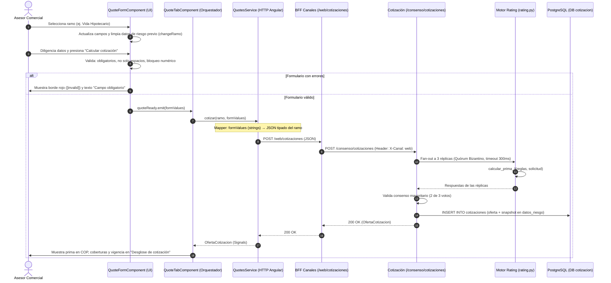

# Documento Maestro de Especificación e Implementación: HU001

> **Propósito de este documento:** Esta especificación es 100% autónoma y autocontenida. Puede ser entregada directamente a cualquier modelo de IA (Claude, ChatGPT, Gemini) o desarrollador de software para implementar la HU001 de punta a punta sin necesidad de contexto previo.

---

## 1. Ficha Técnica de la Historia de Usuario

* **Identificador:** HU001
* **Nombre:** Diligenciar formulario dinámico de cotización por ramo
* **Rol:** Como asesor comercial
* **Objetivo:** Ingresar los datos del cliente en un formulario que se adapte dinámicamente según el ramo seleccionado (viajes, micro seguros, vida hipotecario o paramétrico), para capturar la información exacta requerida sin errores antes de cotizar.
* **Épica Principal:** KAN-1
* **Feature Asociada:** KAN-2 (Feature 1.1: Módulo de Venta Asistida y Cotización en Tiempo Real)
* **Repositorio del Monorepo:** `/Users/jkflorezmorantes/Documents/JersonFlorez/Uniandes/GitUniandes/solventa`
* **Directorio Frontend:** `apps/web/Web.Solventa.Angular` (Angular 22, Standalone, Zoneless, Signals, Tailwind CSS v4)
* **Directorio Backend:** `apps/backend` (Python 3.11+, FastAPI, PostgreSQL 17, Microservicios Clean Architecture)

---

## 2. Criterios de Aceptación y Pruebas Esperadas

### Criterios de Aceptación (CA)
1. **CA-1 (Adaptación dinámica):** Cuando se selecciona un ramo específico en el menú desplegable, los campos del formulario deben cambiar instantáneamente para reflejar únicamente los datos requeridos para ese ramo.
2. **CA-2 (Validación de obligatorios y espacios):** Cuando el asesor intenta avanzar al siguiente paso, el sistema debe validar que ningún campo obligatorio se encuentre vacío o contenga únicamente espacios.
3. **CA-3 (Bloqueo alfabético en numéricos):** Cuando se ingresan datos numéricos (como el valor del crédito hipotecario), el sistema debe impedir el ingreso de caracteres alfabéticos.
4. **CA-4 (Disponibilidad funcional):** Diligenciar correctamente el formulario de cada ramo permite avanzar y deja los datos disponibles para el proceso posterior de cotización.

### Matriz de Pruebas Esperadas
* **P1 (Cambio dinámico por ramo):** Seleccionar viajes, microseguros, vida hipotecario y paramétrico, verificando que en cada caso se muestren únicamente los campos definidos para ese ramo.
* **P2 (Cambio entre ramos):** Cambiar de un ramo a otro durante el diligenciamiento y comprobar que el formulario se actualice sin conservar campos que no correspondan al nuevo ramo.
* **P3 (Campos obligatorios vacíos):** Intentar avanzar dejando uno o más campos requeridos vacíos y verificar que el sistema impida continuar e identifique los campos pendientes.
* **P4 (Campos con espacios):** Ingresar únicamente espacios en un campo obligatorio y comprobar que sea tratado como vacío.
* **P5 (Validación numérica):** Intentar ingresar caracteres alfabéticos en campos numéricos, como el valor del crédito hipotecario, y verificar que no sean aceptados.
* **P6 (Datos válidos):** Diligenciar correctamente el formulario de cada ramo y comprobar que el sistema permita avanzar al siguiente paso.
* **P7 (Flujo funcional Front-Back):** Validar que los datos capturados correspondan al ramo seleccionado, se envíen vía HTTP y generen la oferta de cotización calculada por el backend.

---

## 3. Catálogo de Campos de los 4 Ramos

### A. Campos Comunes del Cliente (en todos los ramos)
| Campo | Clave (`key`) | Tipo | Restricción |
|---|---|---|---|
| Tipo de documento | `tipoDocumento` | Select (`CC`, `CE`, `Pasaporte`) | Obligatorio |
| Número de documento | `numeroDocumento` | Texto numérico (`numeric: true`) | Obligatorio, sin letras |
| Nombre completo | `nombre` | Texto | Obligatorio |
| Correo | `email` | Email (`type: 'email'`) | Obligatorio |
| Celular | `telefono` | Texto numérico (`numeric: true`) | Obligatorio, sin letras |

### B. Campos de Riesgo por Ramo
#### 1. Viajes (`VIAJE` / Producto: `viaje-internacional`)
* `destino`: Select (`Estados Unidos`, `España`, `México`, `Otro país`) — Obligatorio
* `fechaSalida`: Date — Obligatorio
* `fechaRegreso`: Date — Obligatorio (debe ser posterior a salida)
* `viajeros`: Numérico (`numeric: true`) — Obligatorio (mínimo 1)
* `fechaNacimiento`: Date — Obligatorio

#### 2. Microseguros (`MICROSEGURO_VIDA` / Producto: `vida-esencial`)
* `fechaNacimiento`: Date — Obligatorio
* `sumaAsegurada`: Numérico (`numeric: true`) — Obligatorio
* `beneficiario`: Texto — Obligatorio
* `parentesco`: Select (`Cónyuge`, `Hijo(a)`, `Padre / Madre`, `Otro`) — Obligatorio

#### 3. Vida Hipotecario (`VIDA_HIPOTECARIO` / Producto: `vida-hipotecario`) — *Insignia*
* `fechaNacimiento`: Date — Obligatorio
* `entidad`: Texto (placeholder: `Banco Aurora`) — Obligatorio
* `valorCredito`: Numérico (`numeric: true`) — Obligatorio (Bloqueo estricto de letras)
* `plazoAnios`: Numérico (`numeric: true`) — Obligatorio

#### 4. Paramétrico (`PARAMETRICO` / Producto: `parametrico-clima-vuelo`)
* `evento`: Select (`Retraso de vuelo`, `Lluvia excesiva`) — Obligatorio
* `referencia`: Texto (placeholder: `AN-412`) — Obligatorio
* `fechaEvento`: Date — Obligatorio
* `valorIndemnizar`: Numérico (`numeric: true`) — Obligatorio

---

## 4. Arquitectura de Integración Front-Back



---

## 5. Implementación Paso a Paso en Frontend (`apps/web/Web.Solventa.Angular`)

### Paso FE-1: Interfaz de Campo con Flag Numérico
* **Archivo:** `src/app/pages/ops/interfaces/quote-field.interface.ts`
* Añadir `readonly numeric?: boolean;`:
```typescript
export type QuoteFieldType = 'text' | 'email' | 'date' | 'select';

export interface QuoteFieldDef {
  readonly key: string;
  readonly label: string;
  readonly type: QuoteFieldType;
  readonly required: boolean;
  readonly numeric?: boolean; // ← NUEVO: bandera para bloqueo numérico
  readonly placeholder?: string;
  readonly options?: readonly string[];
}
```

### Paso FE-2: Marcar Campos Numéricos en Constantes
* **Archivo:** `src/app/pages/ops/constants/quote-fields.constants.ts`
* Agregar `numeric: true` en:
  * `QUOTE_CLIENT_FIELDS`: `numeroDocumento`, `telefono`.
  * `QUOTE_RISK_FIELDS.VIAJE`: `viajeros`.
  * `QUOTE_RISK_FIELDS.MICROSEGURO_VIDA`: `sumaAsegurada`.
  * `QUOTE_RISK_FIELDS.VIDA_HIPOTECARIO`: `valorCredito`, `plazoAnios`.
  * `QUOTE_RISK_FIELDS.PARAMETRICO`: `valorIndemnizar`.

### Paso FE-3: Bloqueo de Letras en `QuoteFieldComponent`
* **Archivo:** `src/app/pages/ops/components/quote-field/quote-field.component.ts` y `.html`:
* Manejar el evento `(keydown)`:
```typescript
readonly error = input('');

protected blockNonNumeric(event: KeyboardEvent): void {
  if (!this.definition().numeric) return;
  const allowedKeys = ['Backspace', 'Delete', 'Tab', 'ArrowLeft', 'ArrowRight', 'Home', 'End'];
  const isDigit = /^[0-9]$/.test(event.key);
  const isShortcut = event.ctrlKey || event.metaKey;
  if (!isDigit && !allowedKeys.includes(event.key) && !isShortcut) {
    event.preventDefault();
  }
}
```
* En el template:
```html
<slv-field [label]="definition().label" [required]="definition().required" [error]="error()">
  @if (definition().type === 'select') {
    <select slvInput [invalid]="!!error()" [(ngModel)]="value">
      <option value="">Seleccione...</option>
      @for (option of definition().options; track option) {
        <option [value]="option">{{ option }}</option>
      }
    </select>
  } @else {
    <input
      slvInput
      [invalid]="!!error()"
      [type]="definition().type"
      [placeholder]="definition().placeholder ?? ''"
      [(ngModel)]="value"
      (keydown)="blockNonNumeric($event)"
    />
  }
</slv-field>
```

### Paso FE-4: Formulario Dinámico y Validación en `QuoteFormComponent`
* **Archivo:** `src/app/pages/ops/components/quote-form/quote-form.component.ts`:
```typescript
export class QuoteFormComponent {
  readonly ramo = model.required<RamoId>();
  readonly quoteReady = output<Record<string, string>>();

  protected readonly ramos = RAMOS; // Conserva los 6 del catálogo
  protected readonly clientFields = QUOTE_CLIENT_FIELDS;
  private readonly values = signal<Record<string, string>>({ tipoDocumento: 'CC' });
  private readonly submitted = signal(false);

  protected readonly riskFields = computed(() => QUOTE_RISK_FIELDS[this.ramo()] ?? []);
  protected readonly ramoLabel = computed(() => RAMOS.find((r) => r.id === this.ramo())?.label ?? '');

  protected readonly errors = computed(() => {
    if (!this.submitted()) return {} as Record<string, string>;
    const fields = [...QUOTE_CLIENT_FIELDS, ...(QUOTE_RISK_FIELDS[this.ramo()] ?? [])];
    const errs: Record<string, string> = {};
    for (const f of fields) {
      const val = (this.values()[f.key] ?? '').trim();
      if (f.required && !val) {
        errs[f.key] = 'Campo obligatorio';
      }
    }
    return errs;
  });

  protected readonly isValid = computed(() => Object.keys(this.errors()).length === 0);

  protected changeRamo(ramo: RamoId): void {
    const clientKeys = new Set(QUOTE_CLIENT_FIELDS.map((f) => f.key));
    this.values.update((cur) => Object.fromEntries(Object.entries(cur).filter(([k]) => clientKeys.has(k))));
    this.submitted.set(false);
    this.ramo.set(ramo);
  }

  protected submit(): void {
    this.submitted.set(true);
    if (this.isValid()) {
      this.quoteReady.emit({ ...this.values() });
    }
  }
}
```

### Paso FE-5: Corrección de Endpoint y Servicio HTTP
* **Archivo:** `src/app/core/constants/api-endpoints.constants.ts`:
```typescript
quotes: `${environment.apiBaseUrl}/web/cotizaciones`,
```
* **Archivo:** `src/app/pages/ops/services/quote-payload.mapper.ts`:
Convierte los valores del formulario al contrato JSON esperado por el backend para cada ramo (`producto_id`, `number`, `date`).
* **Archivo:** `src/app/pages/ops/services/quotes.service.ts`:
Servicio con `HttpClient` para invocar el endpoint y retornar un `Observable<OfertaCotizacionResponse>`.

### Paso FE-6: Orquestación en `QuoteTabComponent`
* **Archivo:** `src/app/pages/ops/components/quote-tab/quote-tab.component.ts`:
Escucha `(quoteReady)="onQuoteReady($event)"`, llama a `QuotesService`, maneja estados reactivos (`isCalculating`, `quoteResult`, `errorMessage`) y renderiza la prima calculada en el desglose.

---

## 6. Implementación Paso a Paso en Backend (`apps/backend`)

### Paso BE-1: Modelos de Pydantic por Ramo
* **Archivo:** `services/cotizacion/cotizacion/rating/domain/models.py`:
```python
from datetime import date
from decimal import Decimal
from typing import Literal
from pydantic import BaseModel, Field, model_validator

class SolicitudCotizacionViaje(BaseModel):
    producto_id: str = "viaje-internacional"
    destino: Literal["Estados Unidos", "España", "México", "Otro país"]
    fecha_salida: date
    fecha_regreso: date
    viajeros: int = Field(ge=1)
    fecha_nacimiento: date | None = None

    @model_validator(mode="after")
    def _regreso_posterior_a_salida(self) -> "SolicitudCotizacionViaje":
        if self.fecha_regreso <= self.fecha_salida:
            raise ValueError("La fecha de regreso debe ser posterior a la fecha de salida")
        return self

class SolicitudCotizacionMicroseguroVida(BaseModel):
    producto_id: str = "vida-esencial"
    fecha_nacimiento: date
    suma_asegurada: Decimal = Field(gt=0)
    beneficiario: str
    parentesco: Literal["Cónyuge", "Hijo(a)", "Padre / Madre", "Otro"]

class SolicitudCotizacionVidaHipotecario(BaseModel):
    producto_id: str = "vida-hipotecario"
    fecha_nacimiento: date
    entidad: str
    valor_credito: Decimal = Field(gt=0)
    plazo_anios: int = Field(ge=1)

class SolicitudCotizacionParametrico(BaseModel):
    producto_id: str = "parametrico-clima-vuelo"
    evento: Literal["Retraso de vuelo", "Lluvia excesiva"]
    referencia: str
    fecha_evento: date
    valor_indemnizar: Decimal = Field(gt=0)

SolicitudRating = (
    SolicitudCotizacionViaje
    | SolicitudCotizacionMicroseguroVida
    | SolicitudCotizacionVidaHipotecario
    | SolicitudCotizacionParametrico
    | SolicitudCotizacion  # Fallback genérico para preservar tests existentes
)
```

### Paso BE-2: Tarifas Actuariales y Motor de Rating
* **Archivo:** `services/cotizacion/cotizacion/rating/domain/rating.py`:
Implementar funciones determinísticas:
* `calcular_prima_viaje`: ya implementada.
* `calcular_prima_microseguro_vida`: `(suma / 1000) * tasa_base * factor_edad`.
* `calcular_prima_vida_hipotecario`: `(credito / 1000) * tasa_anual * factor_edad * plazo_anios`.
* `calcular_prima_parametrico`: prima fija según evento.
* **Archivo:** `services/cotizacion/cotizacion/rating/domain/use_cases.py`:
Despacho en `CotizarUseCase.execute()` usando `isinstance`.

### Paso BE-3: Vigencias Dinámicas en Consenso
* **Archivo:** `services/cotizacion/cotizacion/consenso/domain/use_cases.py`:
En `_vigencia_propuesta()`:
* Viajes: `desde=fecha_salida, hasta=fecha_regreso`.
* Paramétrico: fecha del evento.
* Vida Hipotecario: `desde=hoy, hasta=hoy + plazo_anios`.
* Microseguros: anual (365 días).

### Paso BE-5: Catálogo de Ramos desde Base de Datos
* **Archivo:** `services/cotizacion/cotizacion/catalogo/api.py`:
  Implementar endpoint `GET /catalogo/ramos` que consulta directamente la tabla `ramos` de PostgreSQL:
  ```python
  @router.get("/ramos")
  def listar_ramos() -> list[dict]:
      with engine.connect() as conn:
          rows = conn.execute(text("SELECT id, nombre FROM ramos ORDER BY nombre ASC")).fetchall()
          return [{"id": r[0], "nombre": r[1]} for r in rows]
  ```
* **Archivo:** `services/canales/canales/web/api.py`:
  Exponer `GET /web/ramos` como proxy hacia el microservicio de cotización:
  ```python
  @router.get("/ramos")
  def listar_ramos() -> list:
      return call_upstream(cotizacion.get, "/catalogo/ramos")
  ```

---

## 7. Garantías de Cero Regresiones (Zero Regressions)

1. **No tocar contratos existentes:** No eliminar campos requeridos ni alterar firmas de funciones existentes.
2. **Preservar el catálogo completo en BD y Socios:** Mantener los ramos completos en `RAMOS` de frontend y en `seed.py` de backend para no afectar el módulo de socios (KAN-40 / KAN-42). El selector de cotización filtra los 4 del alcance de la HU001 e hidrata sus nombres desde la base de datos.
3. **Fallback en Rating:** Conservar `SolicitudCotizacion` genérico en `SolicitudRating` para que los tests preexistentes sigan pasando.
4. **Aditividad en Base de Datos:** Las nuevas columnas en la tabla `cotizaciones` son opcionales (`nullable=True`) con valores por defecto.

---

## 8. Guía de Ejecución y Pruebas Manuales Paso a Paso

### A. Ejecutar el Backend (Docker Compose)
1. Navegar a la carpeta del backend:
   ```bash
   cd apps/backend
   ```
2. Asegurar que el archivo `.env` exista (creado desde `.env.example`).
3. Levantar los contenedores:
   ```bash
   docker compose up -d
   ```
4. Verificar que los contenedores estén saludables (`healthy`):
   ```bash
   docker ps
   ```
   * BFF Canales Web: `http://localhost:8000`
   * Base de datos PostgreSQL: `localhost:5432`

5. Verificar el catálogo de ramos desde BD:
   ```bash
   curl -s http://localhost:8000/web/ramos | jq .
   ```

### B. Ejecutar el Frontend (Angular)
1. Navegar a la carpeta del frontend:
   ```bash
   cd apps/web/Web.Solventa.Angular
   ```
2. Correr las pruebas unitarias automatizadas (22 suites, 110 pruebas):
   ```bash
   npm test -- --watch=false
   ```
3. Iniciar el servidor local de desarrollo:
   ```bash
   npm run start:local
   # o alternativamente:
   ./node_modules/.bin/ng serve --configuration local
   ```
4. Abrir en el navegador:
   `http://localhost:4200/ops`

### C. Procedimiento de Pruebas Manuales en el Navegador
1. **Prueba 1 (Ramos desde BD y exclusivos):**
   * Abrir la pestaña **Cotizar**.
   * Verificar que el menú desplegable de ramos lista **únicamente los 4 ramos**: *Viaje, Microseguro de vida, Vida hipotecario, Paramétrico (clima / vuelo)* con sus nombres sincronizados desde la base de datos.
2. **Prueba 2 (Cambio dinámico y limpieza de riesgo):**
   * Seleccionar **Vida hipotecario**: se muestran los campos específicos (*Fecha de nacimiento, Entidad financiera, Valor del crédito, Plazo en años*).
   * Ingresar un valor de crédito (ej. `250000000`).
   * Cambiar el menú a **Viajes**: el campo del valor de crédito desaparece instantáneamente y se muestran únicamente los campos de viajes (*Destino, Fecha salida, Fecha regreso, Número de viajeros*), manteniendo intactos los datos de cliente si ya se habían ingresado.
3. **Prueba 3 (Bloqueo numérico):**
   * En el campo **Valor del crédito** o **Número de documento**, intentar teclear letras (ej. `a`, `b`, `c`).
   * Comprobar que el teclado no permite el ingreso de ningún carácter alfabético.
4. **Prueba 4 (Validación de obligatorios y espacios):**
   * Intentar hacer clic en **Calcular cotización** con campos vacíos o con solo espacios en blanco.
   * Comprobar que el formulario no avanza, marca los bordes en rojo y muestra el mensaje `Campo obligatorio`.
5. **Prueba 5 (Cotización exitosa en tiempo real):**
   * Diligenciar datos válidos para cualquiera de los 4 ramos.
   * Hacer clic en **Calcular cotización**.
   * Verificar que se muestra la tarjeta de **Desglose de cotización** con la prima calculada en COP, la vigencia propuesta, las coberturas asociadas y la versión de reglas actuariales.

