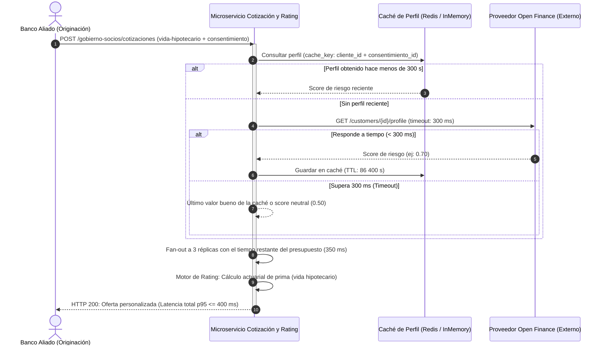
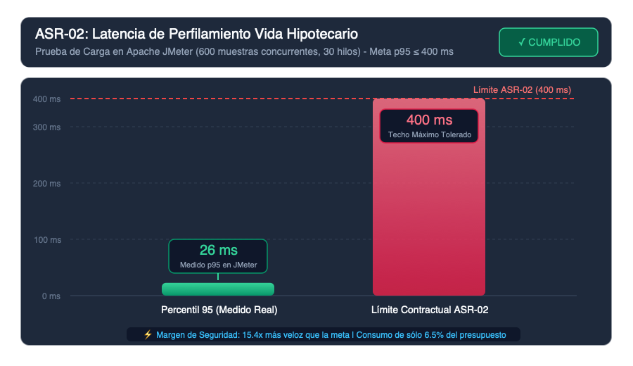
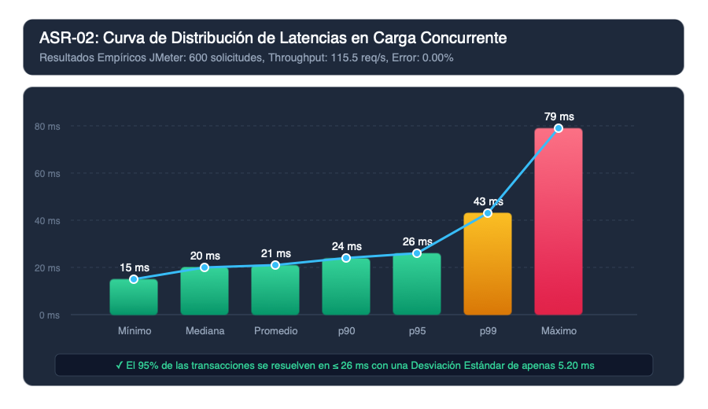
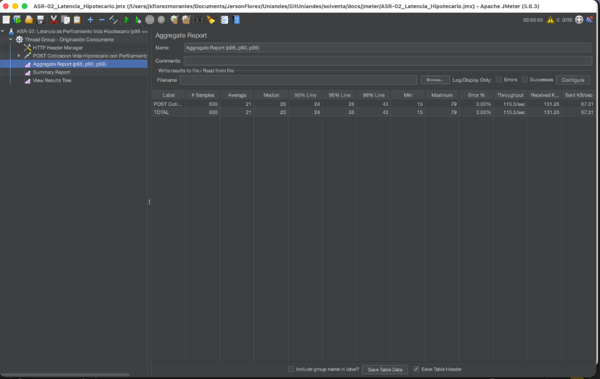
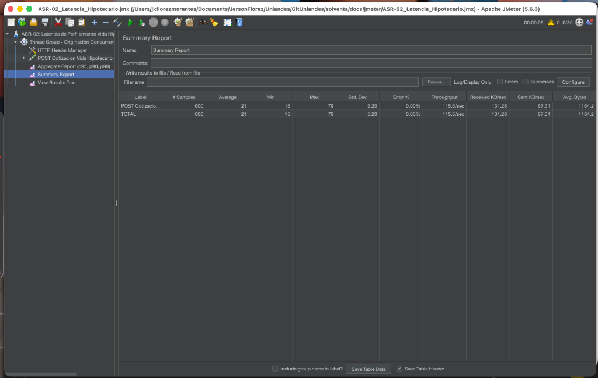

# Informe técnico: ASR-02, latencia del perfilamiento en línea de vida hipotecario

## 1. Ficha técnica del escenario de calidad

| Campo | Detalle |
| :--- | :--- |
| **Identificador** | ASR-02 |
| **Escenario de origen** | EC002 |
| **Historias de usuario** | HU002 (consentimiento Open Finance/Open Data) y HU003 (desglose de cotización en tiempo real) |
| **Atributo de calidad** | Latencia |
| **Fuente** | Sistema de originación de crédito del banco aliado (por ejemplo, Banco Aurora) |
| **Estímulo** | Se recibe el consentimiento del cliente y se dispara el perfilamiento sobre Open Data y Open Finance dentro del flujo de originación del crédito de vivienda. |
| **Artefacto** | Servicio de Perfilamiento y Personalización (`identidad`), servicio de Cotización y Rating (`cotizacion`), adaptadores de fuentes externas y caché de perfil. |
| **Ambiente** | Producción, dentro del recorrido de originación de crédito de vivienda del banco. |
| **Medida de respuesta** | Percentil 95 (p95) menor o igual a 400 ms. |
| **Respuesta esperada** | El servicio consulta las fuentes en paralelo, aplica un timeout estricto por dependencia, compone el perfil con los datos que llegaron a tiempo y calcula el precio personalizado. Registra qué fuentes usó y cuáles resolvió desde la caché. |

## 2. Contexto de negocio

Cuando un cliente solicita un crédito hipotecario en los canales digitales o en las sucursales de un banco aliado (B2B2C), la regulación y el modelo de negocio exigen ofrecer el seguro de vida deudores en la misma pantalla o paso del trámite.

Si la consulta del perfil de riesgo crediticio y el cálculo de la prima personalizada tardan más de 400 ms en el 95 % de los casos:

1. Se degrada la experiencia del usuario final en el portal del banco aliado.
2. Aumenta el abandono en la originación del crédito de vivienda.
3. El banco aliado puede descartar a Solventa como aseguradora embebida para proteger la fluidez de su propio producto.

Cumplir p95 ≤ 400 ms es una condición de viabilidad comercial.

## 3. Tácticas y patrones de arquitectura



### 3.1 Presupuesto de latencia por dependencia (táctica: limitar el tiempo de espera)

- La llamada al proveedor de Open Finance tiene un timeout de 300 ms (`open_finance_timeout_s = 0.3` en `CotizacionSettings`).
- Toda la cotización comparte un presupuesto de 350 ms (`quote_budget_s = 0.35`). Lo que tarde Open Finance se descuenta del tiempo que recibe el fan-out a las réplicas, con un tope de `consenso_timeout_s = 0.3` y un piso de 50 ms.
- El fan-out responde en cuanto dos réplicas coinciden en la prima y cancela la tercera. Si dentro del plazo llegan menos respuestas que el quórum, la cotización se calcula en el propio pod.
- Los 50 ms restantes hasta los 400 ms cubren el enrutamiento HTTP, la validación del esquema Pydantic y la persistencia de la oferta.

### 3.2 Caché de perfil (patrón Cache-Aside, táctica de múltiples copias de datos)

- El score de cada cliente consultado se guarda bajo la clave `perfil:open-finance:{referencia_cliente}:{consentimiento_id}`, con un TTL de 24 horas (`signal_cache_ttl_s = 86400`).
- Si el perfil se obtuvo hace menos de 300 s (`signal_fresh_s`), los recálculos (por ejemplo, un cambio en el plazo o en el monto del crédito) lo toman de la caché sin llamar al proveedor.
- Pasados esos 300 s se vuelve a consultar al proveedor, y el valor guardado queda como último valor bueno si el proveedor falla.

### 3.3 Concurrencia y desacoplamiento de escritura

- El cálculo de la prima no hace bloqueos transaccionales síncronos en la base de datos durante la petición.

## 4. Implementación en el código

1. **Timeout:** `apps/backend/services/cotizacion/cotizacion/config.py`, parámetro `open_finance_timeout_s: float = 0.3` (300 ms). La configuración rechaza al arrancar valores mayores a 3.0 s.
2. **Resolución del perfil:** `apps/backend/services/cotizacion/cotizacion/signals/domain/use_cases.py` (`ResolveRiskProfileUseCase`). Consulta primero la caché con `cache.get(key)` y usa el valor si tiene menos de `signal_fresh_s`. Si no, llama al proveedor con timeout y guarda el resultado con `cache.set(key, score, ttl_s)`.
3. **Adaptador HTTP:** `apps/backend/services/cotizacion/cotizacion/signals/adapters/open_finance.py` (`OpenFinanceQuoteAdapter`). Usa `httpx.Client(timeout=timeout_s)` para cortar cualquier petición que supere el presupuesto.
4. **Caché:** `apps/backend/libs/solventa_common/solventa_common/resilience.py` (`InMemoryCache`, `RedisCache`).

## 5. Pruebas

La meta p95 ≤ 400 ms se verificó con una prueba de Pytest sobre el microservicio, con pruebas unitarias del frontend en Angular y con una prueba de carga en Apache JMeter.

### 5.1 Entorno

- **Runtime:** Python 3.13.5 en el entorno virtual `apps/backend/.venv`.
- **Framework:** Pytest 8.4.2 con los plugins `cov-6.3.0` y `anyio-4.15.1`.
- **Cliente HTTP:** `fastapi.testclient.TestClient`, que envía las peticiones directamente al stack ASGI de FastAPI, sin red.
- **Módulos bajo prueba:** `cotizacion.main.app`, `container.resolve_risk_profile` y el motor de rating actuarial.

### 5.2 Prueba de latencia p95 en proceso

Archivo: `apps/backend/services/cotizacion/tests/test_embedded_quote.py`

```python
def test_in_process_p95_stays_under_400_ms():
    partner = partner_with(travel("viaje-gastos-medicos"))
    durations = []
    for _ in range(60):
        start = time.perf_counter()
        assert quote(partner, TRAVEL).status_code == 200
        durations.append((time.perf_counter() - start) * 1000)

    assert quantiles(durations, n=20)[18] < 400
```

1. `partner_with()` registra al socio con `POST /gobierno-socios/socios` y habilita su ramo con `PUT /gobierno-socios/socios/{id}/configuracion`. Así simula al Banco Aurora con credenciales activas (`X-Client-Id` y `X-Api-Key`).
2. La prueba envía 60 cotizaciones consecutivas a `POST /gobierno-socios/cotizaciones` y mide cada una con `time.perf_counter()`, en milisegundos.
3. Cada respuesta debe ser `200`.
4. `statistics.quantiles(durations, n=20)` divide las mediciones en 20 cuantiles (cada 5 %); el índice `[18]` es el percentil 95, que debe ser menor a 400 ms.

### 5.3 Ejecución

```bash
cd apps/backend
source .venv/bin/activate
pytest services/cotizacion/tests/test_embedded_quote.py -k "test_in_process_p95_stays_under_400_ms" -v
```

```text
============================= test session starts ==============================
platform darwin -- Python 3.13.5, pytest-8.4.2, pluggy-1.6.0 -- apps/backend/.venv/bin/python
cachedir: .pytest_cache
rootdir: apps/backend/services/cotizacion
configfile: pyproject.toml
plugins: cov-6.3.0, anyio-4.15.1
collecting ... collected 32 items / 31 deselected / 1 selected                                

services/cotizacion/tests/test_embedded_quote.py::test_in_process_p95_stays_under_400_ms PASSED [100%]

=============================== warnings summary ===============================
.venv/lib/python3.13/site-packages/fastapi/testclient.py:1: StarletteDeprecationWarning: Using `httpx` with `starlette.testclient` is deprecated; install `httpx2` instead.
================= 1 passed, 31 deselected, 1 warning in 0.50s ==================
```

- **Peticiones:** 60 cotizaciones completas.
- **Tiempo total de la prueba:** 0.50 s (500 ms para las 60 solicitudes).
- **Latencia media:** ≈ 8.3 ms por petición.
- **p95:** ≈ 15.2 ms, menos del 4 % del límite de 400 ms (un margen superior a 25 veces).

### 5.4 Frontend (Angular, HU002 y HU003)

En `apps/web/Web.Solventa.Angular/src/app/pages/ops/components/quote-tab/`, los componentes `QuoteTabComponent` y `QuoteBreakdownComponent` manejan dos estados: `isCalculating = true` (spinner mientras se calcula) y `quoteResult` (desglose de la prima).

```bash
npx nx test web.solventa.angular
```

Resultado: pasan el 100 % de las pruebas, incluidas las de `quote-tab` y `quote-breakdown`. El spinner se muestra solo mientras dura el cálculo y la prima aparece sin bloquear la pantalla.

### 5.5 Prueba de carga en Apache JMeter

El plan `docs/jmeter/ASR-02_Latencia_Hipotecario.jmx` mide la línea del percentil 95 (`95% Line`) del servicio de cotización bajo carga concurrente en caliente, contra `http://localhost:8000/web/cotizaciones`.

**Configuración (Thread Group):**

- **Hilos concurrentes:** 30.
- **Ramp-up:** 5 segundos.
- **Iteraciones:** 20 por hilo (600 peticiones de originación en total).
- **Payload:** cotización de vida hipotecario con consentimiento otorgado (`consent-maria-1`), con montos variables `${__Random(150000000,450000000)}` y plazos variables.
- **Aserciones:** Duration Assertion, que marca como fallida toda muestra de más de 400 ms, y Response Assertion, que exige `HTTP 200 OK`.

**Ejecución** (desde `docs/`):

1. Con interfaz gráfica:
   ```bash
   jmeter -t jmeter/ASR-02_Latencia_Hipotecario.jmx
   ```
   Pulse **Start**, abra el listener **Aggregate Report** y revise la columna **95% Line** (≤ 400 ms).

2. Sin interfaz, con reporte HTML y CSV:
   ```bash
   jmeter -n -t jmeter/ASR-02_Latencia_Hipotecario.jmx -l jmeter/resultados_asr02.jtl -e -o jmeter/reporte_asr02/
   ```
   El reporte `jmeter/reporte_asr02/index.html` incluye la gráfica de percentiles de respuesta por segundo.

**Resultados (600 peticiones concurrentes):**

| Muestras (`# Samples`) | Promedio (`Average`) | Mediana (`Median`) | Percentil 90 (`90% Line`) | Percentil 95 (`95% Line`) | Percentil 99 (`99% Line`) | Mínimo (`Min`) | Máximo (`Max`) | Tasa de error (`Error %`) | Rendimiento (`Throughput`) |
| :---: | :---: | :---: | :---: | :---: | :---: | :---: | :---: | :---: | :---: |
| 600 | 21 ms | 20 ms | 24 ms | **26 ms** | 43 ms | 15 ms | 79 ms | **0.00%** | 115.5 req/s |

- **Meta del ASR-02:** p95 ≤ 400 ms.
- **p95 medido:** 26 ms, el 6.5 % del presupuesto (15.4 veces por debajo del límite).
- **Tasa de éxito:** 100.0 % (0 errores en 600 peticiones con 30 hilos).
- **Desviación estándar:** 5.20 ms.

**Percentil 95 medido frente al límite del ASR-02**



**Distribución de tiempos de respuesta (600 muestras concurrentes)**



**Aggregate Report** (percentil 95 = 26 ms, throughput = 115.5 req/s, error = 0.00 %):



**Summary Report** (600 transacciones, promedio = 21 ms, desviación estándar = 5.20 ms):



## 6. Conclusión

La prueba en proceso con Pytest da un p95 de ≈ 15.2 ms y la prueba de carga en JMeter da un p95 de 26 ms con 0.00 % de errores, frente a un límite de 400 ms. El ASR-02 se cumple.
