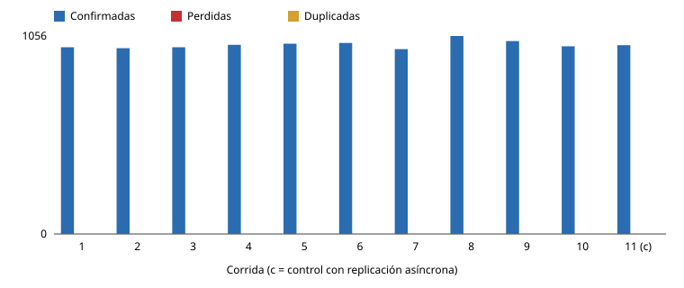

# Informe técnico: ASR-09, cero pérdida de datos ante la caída de una zona

## 1. Ficha técnica del escenario de calidad

| Campo | Detalle |
| :--- | :--- |
| **Identificador** | **ASR-09** (ARQ-14) |
| **Escenario de origen** | **EC009** |
| **Atributo de calidad** | **Disponibilidad** |
| **Fuente** | Proveedor de infraestructura de nube |
| **Estímulo** | Falla una zona de disponibilidad completa con transacciones confirmadas y pagos en curso |
| **Artefacto** | Base de datos relacional con réplica síncrona entre zonas, y las claves de idempotencia de los pagos |
| **Ambiente** | Producción bajo carga normal, durante la falla de una zona |
| **Medida de respuesta** | **RPO = 0**: cero transacciones confirmadas perdidas. Cero pagos duplicados tras el reprocesamiento. Ambas en el 100 % de las conmutaciones. |
| **Respuesta esperada** | La réplica síncrona de otra zona asume el rol primario con todas las transacciones confirmadas. Los pagos sin confirmar se reintentan con su clave de idempotencia y se procesan una sola vez. |

## 2. Tácticas

- **Replicación síncrona entre zonas.** En AWS (modo `eks-costoso`), RDS Multi-AZ confirma un commit solo cuando la réplica de la otra zona lo tiene. En el clúster local, CloudNativePG hace lo mismo con `synchronous` (`method: any`, `number: 1`, `dataDurability: preferred`).
- **Clave de idempotencia en la misma fila del cobro.** La clave es una columna única de `cobros`, así que se replica en el mismo commit que el pago.
- **Reintento seguro.** Si la base no responde, Pagos devuelve `503` con `Retry-After: 2` y el cliente reintenta con la misma clave. La pasarela devuelve el mismo resultado para la misma clave.
- **Reconciliación.** `python -m pagos.cobros.reconciliar` consulta en la pasarela los cobros que quedaron en `procesando`. Nunca vuelve a cobrar.

El modo desplegado por defecto (`ahorro`) corre en una sola instancia EC2 y no cumple ASR-09. Es una decisión de costo del proyecto académico.

## 3. Cómo se probó

Clúster k3d `solventa-ha-local` con dos zonas simuladas (`ha-zone-a`, `ha-zone-b`) y un nodo de control.

1. `node deploy/scripts/ha/modo-local.mjs activar` levanta el clúster y CloudNativePG.
2. `node deploy/scripts/ha/experimento-arq14.mjs --corridas 10` ejecuta las corridas. En cada una, k6 envía 5 cobros por segundo desde el nodo de control, a los 60 s se detiene el nodo de la zona del primario y la carga sigue hasta el final.
3. Tras restaurar el nodo, se ejecuta la reconciliación y se compara el registro del cliente con la tabla `cobros` y con los cargos de la pasarela simulada.
4. `--control` repite una corrida con replicación asíncrona.

Una corrida cumple cuando no hay cobros confirmados perdidos, cobros duplicados ni cobros atascados en `procesando`. La evidencia cruda de cada corrida queda en `experimentation/ha/evidencias/asr09/`.

## 4. Resultados

<!-- resultados:inicio -->
| # | Fecha | Replicación | Zona detenida | Confirmadas | Perdidas | Duplicadas | Atascadas | Cumple |
| --- | --- | --- | --- | --- | --- | --- | --- | --- |
| 1 | 2026-11-20T19:07:50.928Z | Síncrona | ha-zone-b | 996 | 0 | 0 | 0 | Sí |
| 2 | 2026-11-20T19:12:12.296Z | Síncrona | ha-zone-a | 991 | 0 | 0 | 0 | Sí |
| 3 | 2026-11-20T19:16:38.169Z | Síncrona | ha-zone-b | 996 | 0 | 0 | 0 | Sí |
| 4 | 2026-11-20T19:21:09.391Z | Síncrona | ha-zone-a | 1009 | 0 | 0 | 0 | Sí |
| 5 | 2026-11-20T19:25:35.313Z | Síncrona | ha-zone-b | 1015 | 0 | 0 | 0 | Sí |
| 6 | 2026-11-20T19:29:51.136Z | Síncrona | ha-zone-a | 1019 | 0 | 0 | 0 | Sí |
| 7 | 2026-11-20T19:34:27.572Z | Síncrona | ha-zone-b | 986 | 0 | 0 | 0 | Sí |
| 8 | 2026-11-20T19:38:58.790Z | Síncrona | ha-zone-a | 1056 | 0 | 0 | 0 | Sí |
| 9 | 2026-11-20T19:43:30.195Z | Síncrona | ha-zone-b | 1029 | 0 | 0 | 0 | Sí |
| 10 | 2026-11-20T19:52:39.393Z | Síncrona | ha-zone-b | 1001 | 0 | 0 | 0 | Sí |
| 11 | 2026-11-20T19:57:08.445Z | Control (asíncrona) | ha-zone-a | 1007 | 0 | 0 | 0 | Sí |

**10 de 10 corridas cumplen** con replicación síncrona: 10098 cobros confirmados, 0 perdidos, 0 duplicados y 0 atascados. Las corridas de control no cuentan para el resultado.

<!-- resultados:fin -->

## 5. Limitaciones

- Las zonas son contenedores del mismo equipo. La prueba demuestra la replicación síncrona, la idempotencia y la reconciliación, no el comportamiento de red de zonas reales.
- CloudNativePG reemplaza a RDS Multi-AZ. Ambos confirman un commit solo cuando la réplica lo tiene, pero la conmutación es distinta.
- El modo `ahorro` desplegado en AWS no cumple ASR-09.
- La corrida de control con replicación asíncrona tampoco perdió cobros. Con 5 cobros por segundo, el retraso de la réplica es casi cero cuando se detiene la zona, así que el control no demuestra que la comparación detecte una pérdida. Una carga mayor o un retraso inyectado en la réplica lo haría visible.
- La tasa efectiva fue algo menor a 5 cobros por segundo (cerca de 1.000 cobros en 240 s), porque k6 omite llegadas mientras la conmutación hace más lentas las respuestas.
- La corrida 10 se repitió: en el primer intento la conmutación terminó, pero el script falló al leer los cargos de la pasarela (límite de salida de 1 MB) y la corrida no se registró.
