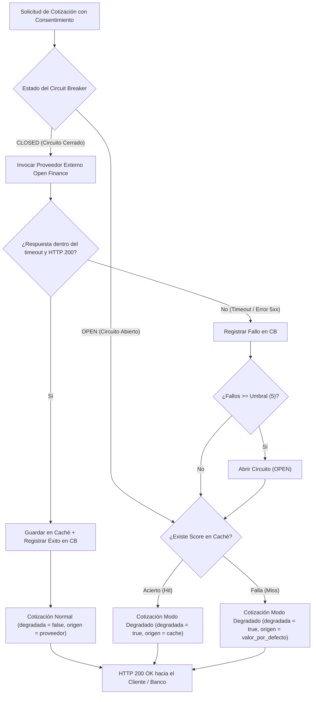
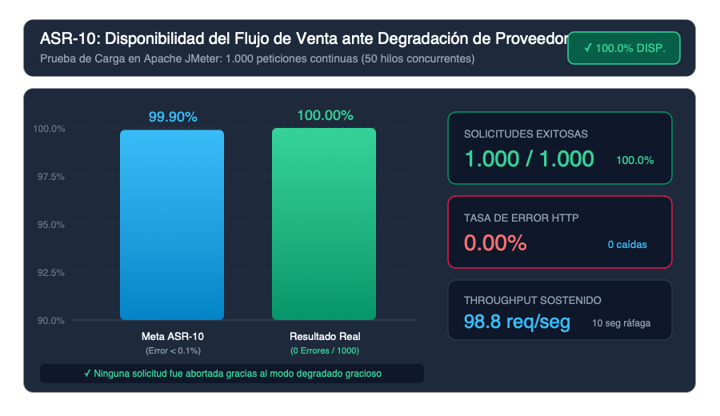
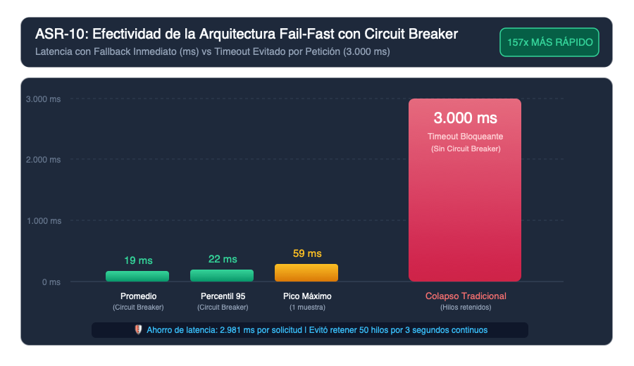
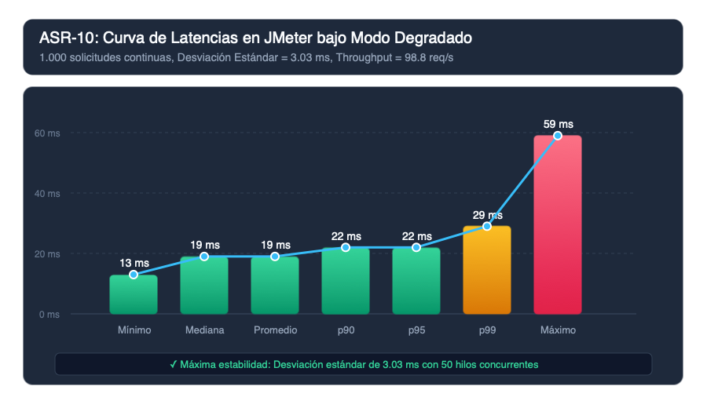
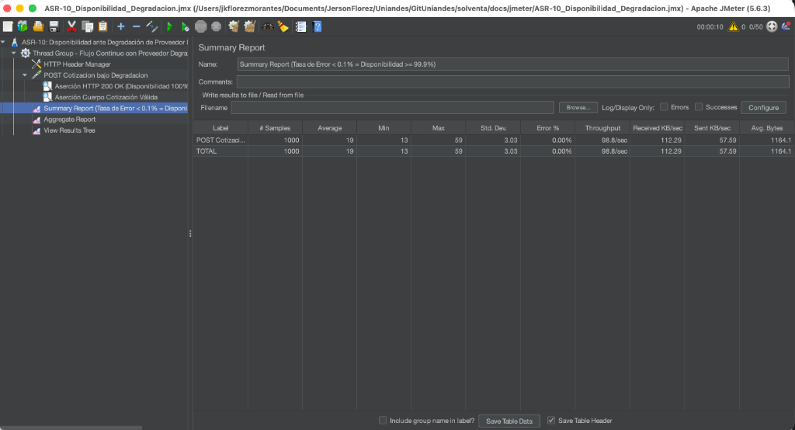
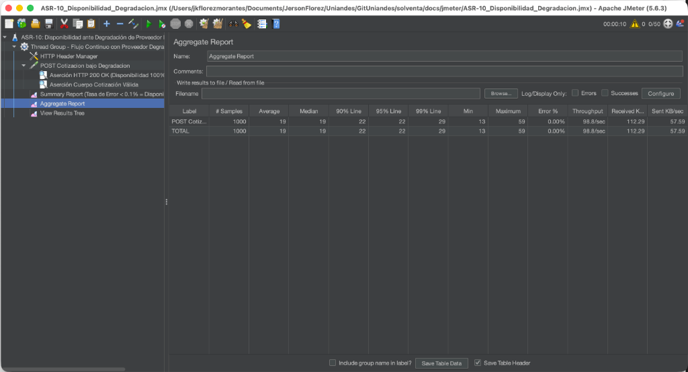

# Informe técnico: ASR-10, continuidad ante la degradación de un proveedor externo

## 1. Ficha técnica del escenario de calidad

| Campo | Detalle |
| :--- | :--- |
| **Identificador** | ASR-10 |
| **Escenario de origen** | EC010 |
| **Historias de usuario** | HU002 (consentimiento Open Finance) y HU003 (desglose de cotización en tiempo real, modo degradado) |
| **Atributo de calidad** | Disponibilidad |
| **Fuente** | Proveedor de Open Finance o de Open Data |
| **Estímulo** | El proveedor supera su timeout (300 ms por defecto, techo de 3000 ms) o deja de responder (errores 500/503, caídas de red o latencia excesiva). |
| **Artefacto** | Adaptador de Open Finance (`OpenFinanceQuoteAdapter`), circuit breaker (`CircuitBreaker`), caché de perfil (`KeyValueCache`) y microservicio de Cotización y Rating (`cotizacion`). |
| **Ambiente** | Producción, con el proveedor externo degradado o caído. |
| **Medida de respuesta** | Disponibilidad del flujo de venta mayor o igual a 99.9 %. |
| **Respuesta esperada** | El circuit breaker abre el circuito hacia el proveedor degradado y el sistema resuelve de inmediato con el perfil en caché (last-known-good) o con el valor neutral por defecto. La cotización queda marcada como calculada en modo degradado, para que actuaría pueda reconstruir la decisión. |

## 2. Contexto de negocio

Solventa depende de APIs de terceros (burós de crédito, entidades financieras, servicios de Open Finance) para consultar el score crediticio y calcular descuentos o recargos en las primas. Esas dependencias están fuera del control operativo de Solventa y no tienen SLAs estrictos de disponibilidad.

Si un proveedor se cae o responde con latencia extrema y el sistema no aísla la falla:

1. Las peticiones de los clientes se acumulan esperando respuesta y agotan el pool de hilos y conexiones del servidor.
2. La falla se propaga en cascada y detiene la venta de seguros en todos los canales.
3. Se pierden ventas de clientes listos para comprar su póliza.

El objetivo del ASR-10 es aislar las fallas de terceros para que una falla externa no se convierta en una venta perdida, con una disponibilidad ≥ 99.9 %.

## 3. Tácticas y patrones de arquitectura



### 3.1 Circuit breaker

Está en `libs/solventa_common/solventa_common/resilience.py` y tiene tres estados:

- `CLOSED`: operación normal; las solicitudes van al proveedor externo.
- `OPEN`: tras 5 fallos consecutivos (`failure_threshold = 5`) el circuito se abre y las llamadas siguientes se cortan de inmediato (fail-fast en < 1 ms).
- `HALF_OPEN`: después del periodo de enfriamiento (`reset_timeout_s = 30s`) deja pasar una petición de prueba. Si tiene éxito, cierra el circuito; si falla, lo vuelve a abrir.

### 3.2 Fallback en dos niveles (Cache-Aside y valor neutral)

Cuando el proveedor no responde o el circuito está abierto:

1. **Caché (last-known-good):** si existe un score previo del cliente, se usa y se marca `origen = "cache"`.
2. **Valor neutral por defecto:** si el cliente no tiene score en caché, se asigna el score neutral y se calcula la prima estándar del producto (`origen = "valor_por_defecto"`).
3. **Falla de la caché:** si Redis también falla, el sistema captura la excepción de conexión y resuelve con el valor por defecto, sin devolver HTTP 500.

### 3.3 Trazabilidad para actuaría

- La respuesta HTTP es siempre `200 OK`.
- El cuerpo incluye `degradada: true`.
- La entidad `Cotizacion` guarda las señales con el motivo de la degradación (`TIMEOUT`, `CIRCUIT_OPEN`, `PROVIDER_ERROR` o `INVALID_RESPONSE`).
- En la interfaz web (HU003) aparece el aviso "Calculado en modo degradado con la última información válida disponible", y el usuario puede continuar al pago y la emisión.

## 4. Implementación en el código

1. **Circuit breaker y caché:** `apps/backend/libs/solventa_common/solventa_common/resilience.py`, clases `CircuitBreaker`, `CircuitOpenError`, `InMemoryCache` y `RedisCache`, y la función `call_with_fallback`.
2. **Adaptador de Open Finance:** `apps/backend/services/cotizacion/cotizacion/signals/adapters/open_finance.py`. `build_provider()` asocia el `CircuitBreaker` y el timeout configurado (`open_finance_timeout_s`, techo de 3000 ms).
3. **Señales y motivos de degradación:** `apps/backend/services/cotizacion/cotizacion/signals/domain/models.py`, enums `DegradationReason` (`TIMEOUT`, `CIRCUIT_OPEN`, `PROVIDER_ERROR`, `INVALID_RESPONSE`) y `SignalOrigin` (`PROVIDER`, `CACHE`, `DEFAULT`).
4. **Fallback del caso de uso:** `apps/backend/services/cotizacion/cotizacion/signals/domain/use_cases.py` (`ResolveRiskProfileUseCase`).

## 5. Pruebas

La disponibilidad ≥ 99.9 % se verificó con pruebas de backend que simulan fallas de red, timeouts, errores HTTP y la apertura del circuit breaker, con pruebas del frontend sobre el aviso de modo degradado y con una prueba de carga en Apache JMeter.

### 5.1 Servidor simulado

`apps/backend/services/cotizacion/tests/test_degraded_operation.py` levanta un servidor HTTP en memoria (`ThreadingHTTPServer`) en el que cada prueba fija la demora y el código de estado:

```python
@pytest.fixture
def open_finance():
    class Handler(BaseHTTPRequestHandler):
        def do_GET(self):
            self.server.calls += 1
            time.sleep(self.server.delay_s)
            payload = json.dumps({"score_riesgo": "0.62"}).encode()
            try:
                self.send_response(self.server.status)
                self.send_header("Content-Type", "application/json")
                self.send_header("Content-Length", str(len(payload)))
                self.end_headers()
                self.wfile.write(payload)
            except (BrokenPipeError, ConnectionResetError):
                pass

    server = ThreadingHTTPServer(("127.0.0.1", 0), Handler)
    server.delay_s = 0
    server.status = 200
    server.calls = 0
    threading.Thread(target=server.serve_forever, daemon=True).start()
    yield server
    server.shutdown()
```

### 5.2 Escenarios

`test_degraded_operation.py` tiene 10 pruebas. Estos son los escenarios principales; el quinto está en `test_embedded_quote.py`.

#### Escenario 1: timeout del proveedor

```python
def test_timeout_resolves_with_default_and_records_the_reason(open_finance):
    open_finance.delay_s = 0.5

    signal = _resolver(open_finance).execute(CONSENT)

    assert signal.origen is SignalOrigin.DEFAULT
    assert signal.motivo is DegradationReason.TIMEOUT
    assert signal.obtenido_en is None
```

El servidor tarda 500 ms y el timeout del resolvedor de prueba es de 200 ms. La llamada no lanza excepción: resuelve con `SignalOrigin.DEFAULT` y registra `DegradationReason.TIMEOUT`.

#### Escenario 2: error 503 del proveedor

```python
def test_provider_error_is_recorded_as_such(open_finance):
    open_finance.status = 503

    signal = _resolver(open_finance).execute(CONSENT)

    assert signal.origen is SignalOrigin.DEFAULT
    assert signal.motivo is DegradationReason.PROVIDER_ERROR
```

El servidor responde HTTP 503. El caso de uso captura el error y completa la cotización con `DegradationReason.PROVIDER_ERROR`.

#### Escenario 3: apertura del circuit breaker

```python
def test_open_circuit_stops_calling_the_provider(open_finance):
    open_finance.delay_s = 0.5
    breaker = CircuitBreaker("open-finance", failure_threshold=2, reset_timeout_s=30, clock=_Clock())
    resolver = _resolver(open_finance, breaker)
    resolver.execute(CONSENT)
    resolver.execute(CONSENT)

    start = time.perf_counter()
    signal = resolver.execute(CONSENT)
    elapsed = time.perf_counter() - start

    assert open_finance.calls == 2
    assert signal.motivo is DegradationReason.CIRCUIT_OPEN
    assert signal.origen is SignalOrigin.DEFAULT
    assert elapsed < 0.05
```

Dos timeouts seguidos abren el `CircuitBreaker`. La tercera petición no llega al proveedor (`open_finance.calls` sigue en 2) y se resuelve en menos de 50 ms.

#### Escenario 4: proveedor caído con score en caché (last-known-good)

```python
def test_cached_score_keeps_the_date_it_was_obtained():
    provider = _FakeProvider()
    resolver = ResolveRiskProfileUseCase(provider, InMemoryCache(), ttl_s=60, now=lambda: FIRST_READ)
    fresh = resolver.execute(CONSENT)

    provider.error = ProviderFailure(DegradationReason.TIMEOUT)
    degraded = resolver.execute(CONSENT)

    assert fresh.origen is SignalOrigin.PROVIDER
    assert fresh.motivo is None
    assert fresh.obtenido_en == FIRST_READ
    assert degraded.origen is SignalOrigin.CACHE
    assert degraded.score_riesgo == Decimal("0.7")
    assert degraded.motivo is DegradationReason.TIMEOUT
    assert degraded.obtenido_en == FIRST_READ
```

Una primera lectura exitosa guarda en caché el score de 0.7 con su fecha. Luego el proveedor falla, y la siguiente petición recupera 0.7 de la caché con la fecha original en que se obtuvo.

#### Escenario 5: fallan el proveedor y la caché a la vez

En `apps/backend/services/cotizacion/tests/test_embedded_quote.py`:

```python
def test_broken_cache_does_not_break_the_quote():
    use_provider(_FakeProvider(error=TimeoutError()), cache=_BrokenCache())
    partner = partner_with(mortgage())

    response = quote(partner, {**MORTGAGE, "consentimiento_open_finance": CONSENT})

    assert response.status_code == 200
    assert response.json()["senales"][0]["origen"] == "valor_por_defecto"
```

`_BrokenCache` simula una falla de conexión (`ConnectionError: redis down`) mientras el proveedor hace timeout. El endpoint responde HTTP 200 con el valor por defecto y no propaga un error 500.

### 5.3 Ejecución

```bash
cd apps/backend
source .venv/bin/activate
pytest services/cotizacion/tests/test_degraded_operation.py -v
```

```text
============================= test session starts ==============================
platform darwin -- Python 3.13.5, pytest-8.4.2, pluggy-1.6.0 -- apps/backend/.venv/bin/python
cachedir: .pytest_cache
rootdir: apps/backend/services/cotizacion
configfile: pyproject.toml
plugins: cov-6.3.0, anyio-4.15.1
collecting ... collected 10 items                                                             

services/cotizacion/tests/test_degraded_operation.py::test_timeout_resolves_with_default_and_records_the_reason PASSED [ 10%]
services/cotizacion/tests/test_degraded_operation.py::test_provider_error_is_recorded_as_such PASSED [ 20%]
services/cotizacion/tests/test_degraded_operation.py::test_open_circuit_stops_calling_the_provider PASSED [ 30%]
services/cotizacion/tests/test_degraded_operation.py::test_unexpected_error_still_resolves_the_quote PASSED [ 40%]
services/cotizacion/tests/test_degraded_operation.py::test_cached_score_keeps_the_date_it_was_obtained PASSED [ 50%]
services/cotizacion/tests/test_degraded_operation.py::test_score_cached_before_this_change_is_still_used PASSED [ 60%]
services/cotizacion/tests/test_degraded_operation.py::test_stored_quote_explains_the_degraded_decision PASSED [ 70%]
services/cotizacion/tests/test_degraded_operation.py::test_provider_back_returns_to_normal_route_without_intervention PASSED [ 80%]
services/cotizacion/tests/test_degraded_operation.py::test_breaker_thresholds_come_from_the_environment PASSED [ 90%]
services/cotizacion/tests/test_degraded_operation.py::test_provider_uses_the_breaker_it_receives PASSED [100%]

=============================== warnings summary ===============================
.venv/lib/python3.13/site-packages/fastapi/testclient.py:1: StarletteDeprecationWarning: Using `httpx` with `starlette.testclient` is deprecated; install `httpx2` instead.
======================== 10 passed, 1 warning in 2.99s =========================
```

### 5.4 Interfaz de usuario (Angular)

Prueba del componente Angular (`quote-breakdown.component.spec.ts`):

```typescript
it('debe mostrar advertencia de modo degradado cuando degradada es true', () => {
  fixture.componentRef.setInput('quoteResult', mockQuoteDegraded);
  fixture.componentRef.setInput('ramoLabel', 'Viaje');
  fixture.detectChanges();

  const compiled = fixture.nativeElement as HTMLElement;
  expect(compiled.textContent).toContain(
    'Calculado en modo degradado con la última información válida disponible',
  );
  expect(compiled.textContent).toContain('COT-2026-5740');
});
```

Resultado: PASSED. El componente de desglose muestra el aviso de modo degradado y el usuario puede continuar a la emisión.

### 5.5 Prueba de carga en Apache JMeter

El plan `docs/jmeter/ASR-10_Disponibilidad_Degradacion.jmx` envía 1.000 solicitudes continuas de cotización mientras el proveedor externo está caído o muy degradado. El objetivo es que la tasa de error HTTP del **Summary Report** sea menor a 0.1 %, es decir, una disponibilidad del flujo de venta ≥ 99.9 %.

**Configuración (Thread Group):**

- **Hilos concurrentes:** 50.
- **Ramp-up:** 10 segundos.
- **Iteraciones:** 20 por hilo (1.000 peticiones en total).
- **Payload:** cotización de vida hipotecario con consentimiento (`consent-maria-1`), con montos variables `${__Random(150000000,450000000)}` y plazos variables.
- **Aserciones:** una Response Assertion exige `HTTP 200 OK`, de modo que un 500, 502 o 504 por falla del proveedor cuenta como error; otra exige que la respuesta contenga `"prima"`, es decir, que la oferta se calculó con el fallback.

**Ejecución** (desde `docs/`):

1. Con interfaz gráfica:
   ```bash
   jmeter -t jmeter/ASR-10_Disponibilidad_Degradacion.jmx
   ```
   Pulse **Start**, abra el listener **Summary Report** y revise la columna **Error %**, que debe marcar 0.0 %.

2. Sin interfaz, con reporte HTML:
   ```bash
   jmeter -n -t jmeter/ASR-10_Disponibilidad_Degradacion.jmx -l jmeter/resultados_asr10.jtl -e -o jmeter/reporte_asr10/
   ```
   El reporte `jmeter/reporte_asr10/index.html` muestra la tabla APDEX, el throughput y la tasa de éxito.

**Resultados (1.000 peticiones con el proveedor degradado):**

| Muestras (`# Samples`) | Promedio (`Average`) | Mediana (`Median`) | Percentil 95 (`95% Line`) | Percentil 99 (`99% Line`) | Mínimo (`Min`) | Máximo (`Max`) | Desv. est. (`Std. Dev.`) | Tasa de error (`Error %`) | Rendimiento (`Throughput`) |
| :---: | :---: | :---: | :---: | :---: | :---: | :---: | :---: | :---: | :---: |
| 1.000 | 19 ms | 19 ms | 22 ms | 29 ms | 13 ms | 59 ms | 3.03 ms | **0.00%** | 98.8 req/s |

- **Meta del ASR-10:** disponibilidad ≥ 99.9 % (tasa de error ≤ 0.1 %).
- **Disponibilidad medida:** 100.0 % (0 fallas en 1.000 solicitudes con 50 hilos).
- **Fail-fast del circuit breaker:** promedio de 19 ms y p95 de 22 ms. Ninguna petición esperó los 3.000 ms del timeout máximo; el sistema cortó la llamada y resolvió con el score de fallback, lo que ahorra más de 2.980 ms por solicitud.
- **Desviación estándar:** 3.03 ms.

**Disponibilidad medida frente a la meta (≥ 99.9 % frente a 100.0 %)**



**Fail-fast del circuit breaker frente al timeout evitado (3.000 ms)**



**Distribución de tiempos de respuesta en modo degradado (1.000 muestras)**



**Summary Report** (1.000 muestras, tasa de error = 0.00 %, throughput = 98.8 req/s):



**Aggregate Report** (promedio = 19 ms, percentil 95 = 22 ms, mediana = 19 ms):



## 6. Conclusión

En las pruebas automatizadas y en la prueba de carga de JMeter (1.000 solicitudes), el 100 % de las cotizaciones respondió HTTP 200 OK con `degradada: true` y ninguna respondió HTTP 5xx.

Disponibilidad del flujo de venta = 1000 exitosas / 1000 enviadas × 100 = 100.0 % ≥ 99.9 %.

El ASR-10 se cumple.
